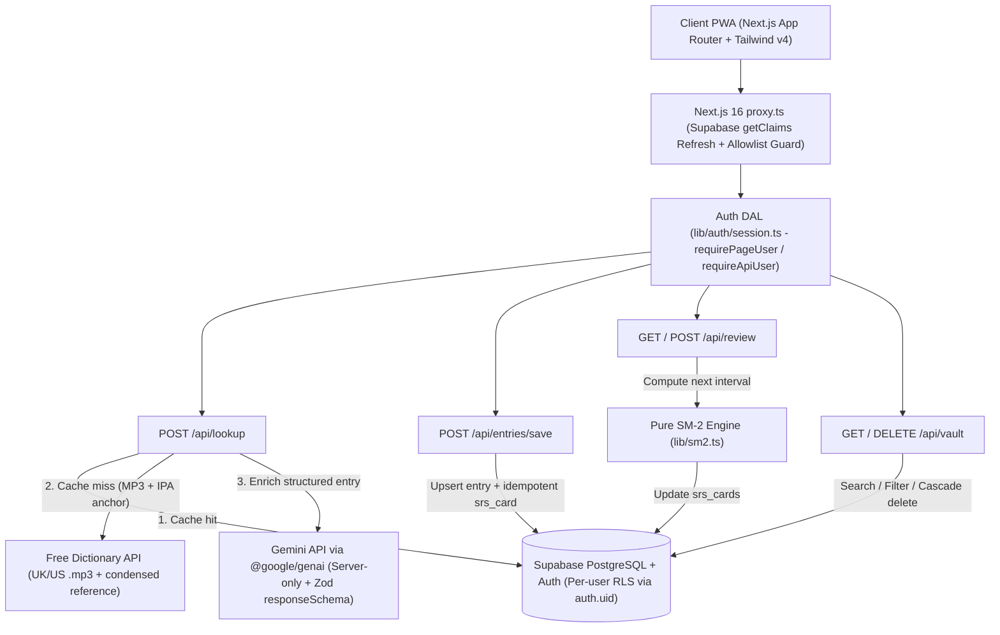

# LexiVault

> A personal **English–Vietnamese dictionary** and **SM-2 spaced-repetition flashcard PWA** — combining authentic UK/US audio, Cambridge-grade English definitions, deep Vietnamese explanations, and cross-device flashcard sync.

[](https://github.com/khoahaaoj/lexivault/actions/workflows/ci.yml)
[](https://github.com/khoahaaoj/lexivault/releases)
[](./LICENSE)


---

## Why LexiVault?

Cambridge Dictionary's English–English definitions are gold-standard, but its English–Vietnamese glosses are often brief or unnatural. **LexiVault** bridges that gap for Vietnamese learners aiming for **IELTS 7.0+** and professional communication:

1. **Real UK / US Pronunciation** — extracts real `.mp3` audio from the Free Dictionary API with automatic **Web Speech API (`en-GB` / `en-US`)** fallback for idioms and phrasal verbs.
2. **Structured AI Enrichment (Server-Only)** — uses `@google/genai` with strict JSON `responseSchema` (`temperature: 0.2`) and Zod validation to generate CEFR level (`A1–C2`), deep Vietnamese explanations, register/grammar nuance notes, high-frequency collocations, synonym comparisons, antonyms, and IELTS-level bilingual examples.
3. **Cache-First Lookup & Clean Vault** — checks your personal Supabase cache before hitting external APIs; only words you click **Save to Flashcards** are persisted to your database and scheduled for review.
4. **SM-2 Spaced Repetition** — pure TypeScript SM-2 engine with 4 ratings (`Again`, `Hard`, `Good`, `Easy`), live interval previews, `1–4` / `Space` desktop shortcuts, and thumb-friendly mobile controls.
5. **Installable Mobile-First PWA** — standalone Home Screen installation on Android and iOS, responsive top navbar (desktop) + bottom bar (mobile), and iOS safe-area support.

---

## Architecture



### Database Schema & Mastery Rules

- **`public.entries`**: User-scoped dictionary entries with normalized lowercase `word` (1–80 chars), `part_of_speech`, `cefr_level` (`A1–C2`), UK/US IPA & `.mp3` URLs, English definition, Vietnamese explanation, nuance note, and JSONB arrays for `collocations`, `synonyms`, `antonyms`, and `examples`. Unique constraint on `(user_id, word, part_of_speech)`.
- **`public.srs_cards`**: 1:1 with `entries` (`ON DELETE CASCADE`), storing `ease_factor` (`>= 1.3`, default `2.5`), `interval_days`, `repetitions`, `next_review_at`, and `last_reviewed_at`.
- **Mastery Classification (`getMasteryStatus`)**:
  - **New**: never reviewed yet (`repetitions === 0` and `last_reviewed_at === null`)
  - **Learning**: reviewed at least once, or lapsed back to `repetitions === 0` after `Again`
  - **Mastered**: `repetitions >= 3` and `interval_days >= 21`

---

## Tech Stack

| Layer       | Choice                                                    |
| ----------- | --------------------------------------------------------- |
| Framework   | Next.js 16 (App Router, Cache Components) · React 19 · TS |
| Styling     | Tailwind CSS v4                                           |
| Validation  | Zod v4                                                    |
| Data & Auth | Supabase (`@supabase/ssr`, Postgres + Row Level Security) |
| AI          | Google Gemini via `@google/genai` (Route Handlers only)   |
| Audio       | Free Dictionary API `.mp3` + Web Speech API fallback      |
| Testing     | Vitest                                                    |
| PWA & CI    | Web App Manifest + PIL Icons · GitHub Actions · Vercel    |

---

## Screenshots

> Add your own captures after deploying or running locally under `docs/screenshots/`:

| Lookup View (Desktop / Mobile)                                                        | Flashcard Flip Review                                                                         | Vocabulary Vault                                                                           |
| ------------------------------------------------------------------------------------- | --------------------------------------------------------------------------------------------- | ------------------------------------------------------------------------------------------ |
|  |  |  |

---

## Project Structure

```text
app/
  api/
    entries/save/    # POST: upsert entry + idempotently create srs_card
    lookup/          # POST: cache-first lookup -> Free Dictionary + Gemini
    review/          # GET due queue, POST SM-2 rating update
    vault/           # GET filtered vault list, DELETE /[entryId]
  auth/callback/     # Supabase email confirmation / PKCE callback
  login/             # Email + password sign-in & sign-up UI + Server Actions
  review/            # SM-2 flip-card review workspace
  vault/             # Saved vocabulary search, filter, detail modal & delete
  error.tsx          # App error boundary
  not-found.tsx      # 404 fallback page
components/
  dictionary/        # Shared CEFR badges, pronunciation buttons & detail sections
  layout/            # AppShell & responsive desktop/mobile navigation
  lookup/            # Search workspace & Cambridge-inspired entry cards
  review/            # Flip card session, progress bar & keyboard shortcuts
  vault/             # Vault filters, stats strip, modal & delete confirmation
lib/
  ai/                # Server-only Gemini prompt & structured schema
  audio/             # UK/US .mp3 playback with Web Speech fallback
  auth/              # Allowlist checks, redirect sanitizer, Zod schemas, DAL
  dictionary/        # Lookup validation, Free Dictionary parser/fetcher, mappers
  env/               # Zod-validated env (pure schema, public, server-only)
  sm2.ts             # Pure TypeScript SM-2 algorithm & interval previews
  srs/               # Review/Vault Zod schemas & PostgREST/filter mappers
  supabase/          # Browser, Server (`io()`-deferred), and Proxy SSR clients
public/
  icons/             # SVG + 192/512/maskable/Apple-touch PNG icons
  manifest.json      # Web App Manifest for standalone PWA install
supabase/migrations/ # 001_init.sql (schema, constraints, indexes & RLS)
proxy.ts             # Next.js 16 session refresh & route/API guard
```

---

## Local Setup

**Prerequisites:** Node.js ≥ 22 (see `.nvmrc`), npm, a free [Supabase](https://supabase.com/) project, and a [Google AI Studio](https://aistudio.google.com/apikey) Gemini API key.

```bash
git clone https://github.com/khoahaaoj/lexivault.git
cd lexivault
npm install
cp .env.example .env.local
```

Fill in `.env.local`:

```bash
NEXT_PUBLIC_SUPABASE_URL=https://your-project-ref.supabase.co
NEXT_PUBLIC_SUPABASE_PUBLISHABLE_KEY=sb_publishable_xxxxxxxxxxxxxxxx
ALLOWED_EMAILS=your-email@gmail.com
GEMINI_API_KEY=your-gemini-api-key
GEMINI_MODEL=gemini-3.5-flash-lite
```

### Run Database Migration

1. Open **Supabase Dashboard → SQL Editor → New query**.
2. Paste [`supabase/migrations/001_init.sql`](./supabase/migrations/001_init.sql) and click **Run**.
3. Verify `entries` and `srs_cards` appear under **Table Editor** with **RLS enabled**.
4. Under **Authentication → URL Configuration**, add `http://localhost:3000/auth/callback` to **Redirect URLs**.

### Start & Verify

```bash
npm run dev          # http://localhost:3000
npm run check        # ESLint + next typegen + tsc --noEmit + Vitest
npm run format:check # Prettier check
npm run build        # Production Next.js build
```

---

## Security & Quota Protection

- **4-Layer Email Allowlist (`ALLOWED_EMAILS`)**: Enforced across Sign-up/Sign-in Server Actions, `/auth/callback`, Next.js `proxy.ts`, Server Components (`requirePageUser`), and `/api/*` routes (`requireApiUser`).
- **Disable Public Signups**: After creating your personal account, disable **Allow new users to sign up** in **Supabase Dashboard → Authentication → Sign In / Providers → User Signups**.
- **Server-Only AI Keys**: `lib/ai/dictionary-schema.ts` and `lib/env/server.ts` import `server-only`, failing the build if accidentally imported by Client Components.
- **Database Row Level Security**: Every query is verified against `(select auth.uid()) = user_id` in Postgres RLS, including cross-table ownership checks on `srs_cards`.
- **HTTP Security Headers**: `X-Content-Type-Options: nosniff`, `X-Frame-Options: DENY`, `Referrer-Policy`, and `Permissions-Policy` configured in `next.config.ts`.

---

## Vercel Free-Tier Deployment Checklist

1. **Import Repository**: On [Vercel](https://vercel.com/), click **Add New → Project** and select `khoahaaoj/lexivault` (Framework Preset: **Next.js**).
2. **Configure Environment Variables** in Vercel **Project Settings → Environment Variables**:
   - `NEXT_PUBLIC_SUPABASE_URL`
   - `NEXT_PUBLIC_SUPABASE_PUBLISHABLE_KEY`
   - `ALLOWED_EMAILS` _(your personal email(s), comma-separated)_
   - `GEMINI_API_KEY` _(server-only)_
   - `GEMINI_MODEL` _(e.g. `gemini-3.5-flash-lite`)_
3. **Deploy**: Click **Deploy** and note your production URL (e.g. `https://lexivault.vercel.app`).
4. **Update Supabase Production Auth URLs**:
   - In **Supabase Dashboard → Authentication → URL Configuration**:
     - Set **Site URL** to `https://lexivault.vercel.app`.
     - Add `https://lexivault.vercel.app/auth/callback` to **Redirect URLs**.
   - Confirm **Allow new users to sign up** is turned **off** if you want strictly personal access.
5. **Install as Mobile PWA**:
   - **Android (Chrome)**: Open your Vercel URL → tap **⋮ → Install app** (or **Add to Home screen**).
   - **iOS (Safari)**: Open your Vercel URL → tap **Share → Add to Home Screen**.

---

## Roadmap

- [x] **Phase 1** — Scaffold, Git hygiene, CI
- [x] **Phase 2** — Supabase schema (RLS), session proxy, allowlist & email/password auth
- [x] **Phase 3** — Hybrid dictionary engine (`POST /api/lookup`, save to flashcards, audio fallback)
- [x] **Phase 4** — SM-2 engine, unit tests, flashcard review & Vault
- [x] **Phase 5** — PWA polish, architecture docs & Vercel deployment checklist

## License

[MIT](./LICENSE)
